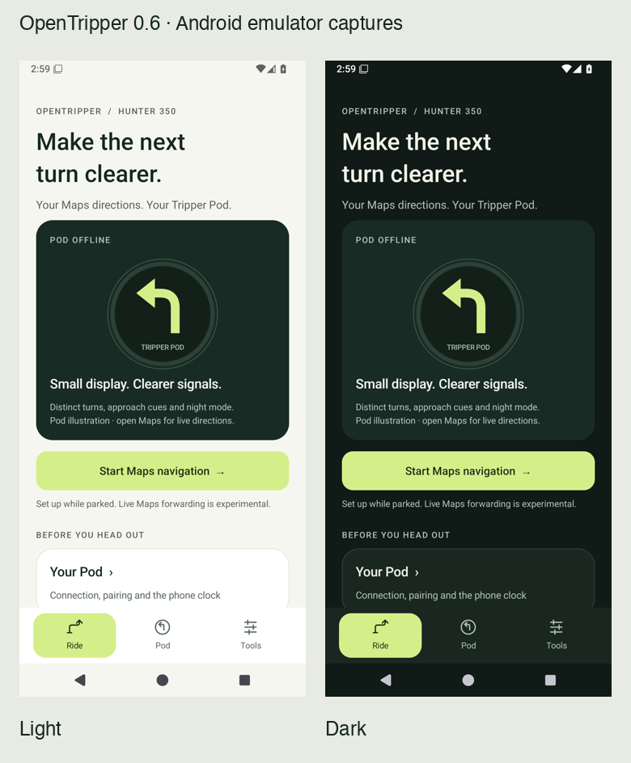

# OpenTripper mobile UI

The 0.6 interface organizes everyday use into Ride, Pod and Tools. It uses native Android Views, shared semantic color tokens, system light/dark themes, a consistent spacing/type scale, at least 48 dp interactive targets and Android system-bar insets. The BLE service and core protocol are shared with 0.5.

## Installed design skills

The following MIT-licensed skills were installed from [wshobson/agents](https://github.com/wshobson/agents/tree/7e2fb559cf4b824b27f1fec49fe88f7511066d26/plugins/ui-design/skills), pinned to commit `7e2fb559cf4b824b27f1fec49fe88f7511066d26`. Each local skill retains its upstream license and installation-source record.

- **mobile-android-design**: Android hierarchy, navigation, accessibility and clear connection states. Its Compose examples are adapted to the existing native View implementation.
- **visual-design-foundations**: shared palette, typography, spacing, contrast and surface hierarchy.
- **interaction-design**: native press ripples, visible expanded/collapsed state, actual progress and state-specific feedback; no ornamental or looping animation.

## Product decisions

- Ride offers one primary Maps action and clearly labels the decorative Pod illustration. It never presents a sample direction as an active route.
- Pod separates discovery/PIN entry, permissions and device actions. A saved Pod is remembered only after the user checks its response.
- Maps presents connection, route selection and recognized directions as three steps; existing permission and stale-notification behavior remains.
- Test screens prioritize current progress, requested photos and pairing. Selection, retries and help have separate disclosure sections. Saved reports remain available.
- The lab distinguishes a phone schematic from actual Pod rendering. Firmware/pixel control is not implied.
- Camera capture, review, retake and permission states have distinct actions; the preview is bounded and controls scroll on short displays.
- Existing photos/report formats are retained. New reports use the generated app version rather than a hardcoded version string.

See [actual build and emulator evidence](UI_VALIDATION_2026-11-03.md), including camera capture/review, large text, compact layout and the 0.5 report upgrade. Phone installation remains pending reconnection.
